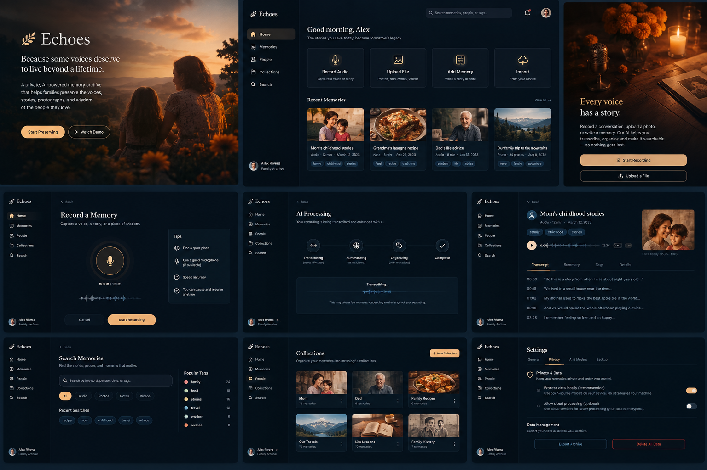

# Echoes — The Memories That Stay 🕯️🕊️

> **A Private, AI-Powered Memory Archive Honoring the People We Love**  
> *Built for the DEV Hacktoberfest 2026 Week 4 Challenge: Ghost in the Machine (#devchallenge #hf26challenge).*

---



## 🕊️ What is Echoes?

Every family carries a sacred library of stories, laughter, and generational wisdom:
- A mother's secret ingredient whispered on Sunday mornings.
- A sister's contagious laugh and her quiet advice on courage.
- A grandfather's weathered pocket watch and his lessons on the value of time.

Too often, when the people we love pass away, their voices and stories fade from living memory. **Echoes** is an enduring digital sanctuary designed to preserve family voices, life lessons, photographs, and oral histories before they disappear.

### Our Core Philosophy: Authentic Remembrance, Never Artificial Imitation
Echoes explicitly **does not** create synthetic chatbots that pretend to speak as a deceased mother, sister, or elder. There is something deeply dishonest about algorithmic imitation. Instead, Echoes keeps their **real voice recordings, exact words, photographs, and authentic wisdom** at the absolute center of the experience.

---

## ✨ Key Features

1. **🎙️ ElevenLabs Commemorative Voice Narration**:
   - Every preserved memory story can be narrated aloud with neural speech from ElevenLabs, allowing families to listen to bedtime stories, recipes, and life advice with emotional reverence.
   - Pre-loaded with authentic heirloom stories (e.g. *Mom's Sunday Apple Pie*, *Sister's Laughter by the Lake*, *Grandpa's Pocket Watch*).

2. **🧠 Open-Weight AI Wisdom & Tribute Extraction**:
   - Powered by genuine open-weight models (`qwen/qwen3.8-27b` / `gemma`) on **Groq LPU inference**.
   - Extracts the core **Life Lesson / Wisdom Quote**, identifies **People & Timelines**, generates a heartfelt **Memorial Tribute**, and organizes memories with **Heirloom Tags**.

3. **🎵 Ambient Candlelight Atmosphere**:
   - Built-in soothing acoustic piano chords and candlelight soundscape synthesized with the Web Audio API (with live volume and mute toggles in the header).

4. **🎙️ In-Browser High-Fidelity Voice Recording**:
   - Record authentic spoken stories directly from your microphone with live elapsed timers and audio waveforms.

5. **🔒 Sovereignty & Privacy by Design**:
   - Zero corporate data harvesting. Family grief and heirloom memories are never fed into public training datasets. Compatible with local offline open-weight execution.

---

## 🛠️ Technology Stack

- **Frontend**: React 19, TypeScript, Next.js 16 (App Router), Tailwind CSS v4.
- **Voice Narration**: ElevenLabs Neural Text-to-Speech (`eleven_turbo_v2_5`).
- **AI Core**: Open-weight instruction models on Groq Cloud LPU.
- **Audio & Media**: Web Audio API, MediaRecorder API, HTML5 Audio.
- **Design & Typography**: Warm editorial obsidian palette (`#0B0F14`) with amber candlelight accents (`#F59E0B`, `#D97706`).

---

## 🚀 Getting Started Locally

### 1. Clone the repository
```bash
git clone https://github.com/Misterhoye10/Echoes.git
cd Echoes
```

### 2. Install dependencies
```bash
npm install
```

### 3. Configure environment variables
Create a `.env.local` file based on `.env.example`:
```bash
cp .env.example .env.local
```
Add your keys:
```env
ELEVENLABS_API_KEY=your_elevenlabs_key
GROQ_API_KEY=your_groq_key
```

### 4. Run the development server
```bash
npm run dev
```
Open **[http://localhost:3000](http://localhost:3000)** in your browser!

---

## 🏆 Hackathon Tracks & Categories

- **Primary Track**: *Ghost in the Machine* (Honoring the past in the spirit of Día de los Muertos).
- **Partner Categories**:
  - 🎙️ **Best Use of ElevenLabs** ($100 USD)
  - 🧠 **Best Use of Gemma / Open-Weight AI** ($200 USD)
  - 🚀 **Best Use of Render** ($200 USD)

---

## 🕯️ In Memoriam
*Dedicated with love to mothers, sisters, and elders whose voices and wisdom deserve to live beyond a lifetime.* ❤️
